<p align="center"></p>

<p align="center">
  
  
  
  
  <a href="https://github.com/Bresqwik/void-draconic-pack/releases/latest"></a>
  
</p>

<p align="center">
  <a href="#installation"></a>
  <a href="https://mc-void-draconic.duckdns.org"></a>
  <a href="https://github.com/Bresqwik/void-draconic-pack/releases"></a>
  <a href="MODLISTE.md"></a>
  <a href="#server"></a>
</p>

<p align="center">
  <b>Void &amp; Draconic</b> ist ein Kitchen-Sink-Modpack für eine feste Runde Freunde: viel Technik und Automatisierung, Magie, neue Dimensionen und harte Bosse.<br>
  Im Mittelpunkt steht der <b>Void Miner</b>, der Erze und Kristalle aus der Leere holt – am Ende wartet <b>Draconic Evolution</b> und der Chaos-Drache.
</p>

<p align="center"></p>

<a name="ueberblick"></a>
<p align="center"></p>

<p align="center"></p>

| | |
|---|---|
| 🎮 **Für wen** | Eine feste Runde von bis zu 10 Spielern auf einem eigenen Server, gemeinsam im Team |
| 🧭 **Spielweise** | Questbuch mit sieben Ären als roter Faden – dazu viele Mod-Kapitel zum freien Erkunden |
| ⚙️ **Schwerpunkt** | Technik & Automatisierung (Mekanism, Create, Refined Storage, Draconic) mit Magie und Abenteuer |
| 🗺️ **Welten** | Overworld, Nether, End und 8 Mod-Dimensionen – alle vorgeneriert, damit nichts ruckelt |
| 🔄 **Updates** | Prism lädt neue Versionen beim Start automatisch – Client und Server bleiben synchron |
| 🧠 **RAM** | Spiel 10 GB (voreingestellt), Rechner mindestens 16 GB |

<a name="features"></a>
<p align="center"></p>

<p align="center"></p>

<table>
<tr>
<td width="50%" valign="top">

**⚙️ Technik**
Mekanism mit Fusionsreaktor und MekaSuit · Create · Immersive Engineering · Industrial Foregoing · Ender IO · Powah · Flux Networks · Refined Storage mit Autocrafting · Draconic Evolution bis zum Chaos-Kern

</td>
<td width="50%" valign="top">

**✨ Magie**
Botania mit Addons · Ars Nouveau · Blood Magic · Iron's Spells · Eidolon · Occultism · Nature's Aura · Forbidden Arcanus · Psi

</td>
</tr>
<tr>
<td valign="top">

**🗺️ Abenteuer**
Twilight Forest · The Aether · Blue Skies · The Bumblezone · The Abyss · Deeper and Darker · Alfheim · Cataclysm-Bosse · Cracker's Wither Storm

</td>
<td valign="top">

**🎒 Komfort**
EMI & JEI · Jade · FTB Quests, Chunks & Teams · Sophisticated Backpacks · Waystones · Grabsteine · Simple Voice Chat · Shader (Complementary, BSL)

</td>
</tr>
</table>

<a name="progression"></a>
<p align="center"></p>

<p align="center"></p>

Das Questbuch führt in **sieben Ären** durch das Pack. Jede Ära schaltet die nächste frei, daneben gibt es Kapitel für jede große Mod, Bosse, Geheimnisse und Kopfgelder. Wer ein Kapitel abschließt, bekommt **Void-Kisten** – bei schweren Kapiteln mehr.

<a name="voidminer"></a>
<p align="center"></p>

<p align="center"></p>

Der **Void Miner** aus *Environmental Tech* ist ein Multiblock mit Steuereinheit und Laser, der Erze, Ressourcen und Kristalle aus der Leere holt. Jede Stufe baut mit dem Kristall-Programm den Kristall der nächsten Stufe ab – von **Litherite** bis **Xerothium**, die letzten Stufen nur im End. Environmental Tech gab es nur bis 1.16.5; für dieses Pack wurde es auf 1.20.1 portiert.

<a name="installation"></a>
<p align="center"></p>

<p align="center"></p>

1. **[Prism Launcher](https://prismlauncher.org/) installieren** und unter *Konten* mit dem Microsoft-Konto anmelden.
2. **Instanz importieren:** *Instanz hinzufügen* → *Importieren* → diesen Link einfügen → **OK**

   ```
   https://github.com/Bresqwik/void-draconic-pack/releases/latest/download/Void-Draconic-Prism.zip
   ```

3. **Starten.** Der erste Start lädt alle Mods und dauert ein paar Minuten. Danach kommen nur noch Updates, automatisch bei jedem Start.
4. **Mitspielen:** *Mehrspieler* → **Void &amp; Draconic**. Noch nicht freigeschaltet? Bei Stefan melden – er setzt dich auf die Whitelist.

> [!TIP]
> RAM (10 GB), Forge und Auto-Update sind in der Instanz schon eingestellt, Java 17 lädt Prism selbst. Fehlt der Server in der Liste: `mc-void-draconic.duckdns.org`

<details><summary><b>Ohne Import von Hand einrichten</b></summary>

1. In Prism eine Instanz mit Minecraft **1.20.1** und **Forge 47.4.26** anlegen.
2. [`packwiz-installer-bootstrap.jar`](https://github.com/packwiz/packwiz-installer-bootstrap/releases/latest) in den Ordner `minecraft` der Instanz legen (Rechtsklick auf die Instanz → *Ordner*).
3. *Bearbeiten* → *Einstellungen* → *Eigene Befehle* → bei *Befehl vor dem Start* eintragen:

   ```
   "$INST_JAVA" -jar packwiz-installer-bootstrap.jar https://raw.githubusercontent.com/Bresqwik/void-draconic-pack/main/pack.toml
   ```

4. Unter *Java* den maximalen Speicher auf **10240 MB** setzen und starten.

</details>

<a name="dashboard"></a>
<p align="center"></p>

<p align="center"><a href="https://mc-void-draconic.duckdns.org"></a></p>

<p align="center"></p>

Unter **[mc-void-draconic.duckdns.org](https://mc-void-draconic.duckdns.org)** läuft das Server-Dashboard (Login für Mitspieler): TPS, RAM und Spieler live, der Minecraft-Chat zum Mitlesen und Schreiben, Meldungen aus dem Spiel, Backups, Vorgenerierung, die Modliste und welche Pack-Version jeder gerade spielt.

> [!TIP]
> Etwas kaputt oder ruckelt es? Im Spiel `/meldung <Text>` für Fehler und `/lag` bei Rucklern – beides landet direkt im Dashboard.

<a name="neu"></a>
<p align="center"></p>

**Zuletzt – Version 0.6.21**

- 🧩 **EMI:** Chipped- und Rechiseled-Werkbänke zeigen ihre Varianten wieder sauber im Raster – und tausende Fehlerzeilen beim Spielstart sind weg

**Version 0.6.20**

- 🎰 **Void-Kiste überarbeitet:** 52 Funde, keine Abkürzungen mehr durch die Progression – neu u. a. Netherit-Zauberbuch, Kristallherz, Wormhole Mirror und als ★ Jackpot das Wyvern-Schwert (1 von 2.000)
- 🔧 **Refined Storage:** Autocrafting für Upgrade-Rezepte (Jetpacks, Sophisticated Kisten und Rucksäcke) funktioniert
- 🚀 **Weniger Lag beim Fliegen:** überflogene Chunks werden wieder entladen
- 🏆 **Mystischer Meister:** große Gratulation, Sieger-Animation, 20 Void-Kisten und der Titel „Mystischer Meister“, wenn ein Team alle Mystical-Agriculture-Quests schafft
- 🌱 **Mystical Agriculture abgekapselt:** Essenz ergibt keine Ressourcen mehr (weder Vanilla noch andere Mods) – MA dient nur noch seinen eigenen Samen, Werkzeugen, Rüstungen und Maschinen; andere Mods dürfen MA-Sachen weiter verarbeiten. Die Void-Kern-Komponente „Ressourcen“ kommt jetzt aus dem Void Miner (Aethium, Ionite, Aethium Void Miner CCU)
- 🧊 Sporadischer Startabsturz und endloser Frost durch Frostmunition behoben

**[→ Alle Versionen und Änderungen](https://github.com/Bresqwik/void-draconic-pack/releases)**

<a name="server"></a>
<p align="center"></p>

<p align="center"></p>

- **Whitelist:** Nur eingetragene Spieler – einfach bei Stefan melden.
- **Sprachchat:** Simple Voice Chat ist eingebaut (Taste in den Einstellungen).
- **Updates ohne Unterbrechung:** Der Server startet nie neu, solange jemand spielt. Eilt ein Update, fragt der Server alle Online-Spieler im Chat (`/neustart ja|nein`) und sagt dazu, was neu ist und ob das Spiel neu gestartet werden muss.
- **Sicher:** Automatische Backups, die geprüft in die Cloud wandern.

<a name="technik"></a>
<p align="center"></p>

| | |
|---|---|
| 🧱 **Basis** | Minecraft 1.20.1 · Forge 47.4.26 · Java 17 |
| 🧩 **Mods** | 370 Einträge, davon 44 nur im Client und 9 nur auf dem Server · 3 Shaderpacks |
| 📦 **Pack-Format** | [packwiz](https://packwiz.infra.link/) – dieses Repo enthält nur Links und Prüfsummen, die Dateien kommen direkt von Modrinth und CurseForge |
| 📜 **Quests** | FTB Quests: 1.204 Quests in 55 Kapiteln, gemeinsamer Fortschritt im Team |
| 🛠️ **Eigene Mods** | **vd-fixes** – Fehlerkorrekturen per Mixin: EMI-Absturz bei Werkbankrezepten, Bountiful-Baubles-Doppelsprung, Void-Kisten-Feinschliff, Wither-Storm-Fluchtziel, Chunk-Leck von Just Dire Things, Netzwerkauswahl im Flux Configurator, Refined-Storage-Autocrafting mit NBT, Startabsturz durch Zeta · **Environmental Tech** (+ Environmental Core, ValkyrieLib) als Port von 1.16.5 auf 1.20.1 |
| 🧪 **Skripte** | KubeJS: Rezept-Anpassungen, Void-Kisten-Quellen, Kapitel-Belohnungen, `/meldung`, `/lag`, `/mafortschritt`, Neustart-Abfrage, Force-Load-Wächter |
| 🗺️ **Welt** | Overworld bis 15.000 Blöcke vorgeneriert (rund 3,5 Mio. Chunks), Nether/End 2.000, Mod-Dimensionen 1.000 · Schwierigkeit Hard · Sichtweite 10, Simulationsweite 5 |
| 🖧 **Server** | Eigener Mietserver (12 Kerne, Debian 12), 16 GB RAM für Minecraft · C2ME für schnelle Weltgenerierung · Simple Voice Chat |
| 🔁 **Ablauf** | Änderung → Test auf einer eigenen Test-Instanz → Push auf GitHub → Prism und Server holen das Update beim nächsten Start |

<details><summary><b>🚀 Performance-Mods im Detail</b></summary>

<table>
<tr><th>🖥️ Nur im Client (mehr FPS)</th><th>🖧 Client und Server (TPS, RAM, Stabilität)</th></tr>
<tr><td valign="top">

- **Embeddium**: Deutlich mehr FPS. Ersetzt Sodium.
- **Rubidium Extra**: Mehr Grafikoptionen für Embeddium und ein FPS-Overlay.
- **Oculus**: Shader-Unterstützung, ersetzt Iris. Complementary Reimagined, Complementary Unbound und BSL sind dabei.
- **ImmediatelyFast**: Schnelleres Zeichnen von Text und Oberflächen.
- **Entity Culling**: Zeichnet nichts, was hinter Wänden liegt.
- **BadOptimizations**: Viele kleine Optimierungen bei Licht und Himmel.
- **Dynamic FPS**: Drosselt das Spiel im Hintergrund, ideal beim AFK-Farmen.
- **Better Biome Blend**: Schnellere, weichere Farbübergänge zwischen Biomen.

</td><td valign="top">

- **ModernFix**: Schnellerer Start, weniger RAM.
- **FerriteCore**: Weniger RAM-Verbrauch.
- **AllTheLeaks**: Behebt Speicherlecks verschiedener Mods.
- **Canary**: Forge-Port von Lithium. Optimiert Mobs, Physik und Server-Ticks.
- **Structure Layout Optimizer**: Schnellere Generierung großer Strukturen.
- **FastSuite**: Schnellere Rezeptsuche in Maschinen.
- **FastWorkbench**: Schnellere Werkbank und Autocrafting.
- **FastFurnace**: Schnellere Rezeptsuche in Öfen.
- **Let Me Despawn**: Mobs mit aufgehobenen Items verschwinden trotzdem. Weniger Entities.
- **Packet Fixer**: Verhindert Kicks bei großen Grids und vollen Rucksäcken.
- **Neruina**: Fängt fehlerhafte Mobs und Blöcke ab, statt die Welt abstürzen zu lassen.
- **Connectivity**: Behebt Verbindungsabbrüche. Login-Timeout 120 s und Verbindungs-Timeout 180 s, weil JEI beim ersten Join rund 40 s lädt.
- **Noisium**: Nur Server. Schnellere Gelände-Berechnung bei der Weltgenerierung.
- **AI Improvements**: Nur Server. Schnellere Mob-KI.

</td></tr>
</table>

> [!TIP]
> **Shader:** In den Videoeinstellungen unter *Shader Packs* Complementary Reimagined, Complementary Unbound oder BSL wählen. Kostet je nach Grafikkarte deutlich FPS.

**Analyse & Debugging**

- **spark**: Profiler für TPS, MSPT, RAM und Lag-Verursacher. Pflicht.
- **Observable**: Zeigt Lag als Heatmap direkt in der Welt.
- **Crash Assistant**: Nur Client. Erklärt Abstürze und lädt Logs zum Teilen hoch.
- **BetterF3**: Nur Client. Aufgeräumter F3-Bildschirm.

</details>

<details><summary><b>Optional, nicht im Pack</b></summary>

Kann bei Bedarf dazukommen – vorher prüfen, ob es eine Version für Forge 1.20.1 gibt und ob sie sich mit Embeddium und Oculus verträgt.

- **[Distant Horizons](https://modrinth.com/mod/distanthorizons)**: Nur Client. Sehr weite Sicht, braucht starke Grafikkarte und viel RAM.
- **[Fast IP Ping](https://modrinth.com/mod/fast-ip-ping)**: Nur Client. Server-Liste lädt schneller.

</details>

<a name="mods"></a>
<p align="center"><a href="MODLISTE.md"></a></p>

<p align="center"><b><a href="MODLISTE.md">→ Komplette Modliste mit Beschreibungen, nach Bereichen sortiert</a></b></p>

<p align="center"></p>

<p align="center"><sub>Alle Mods gehören ihren Autorinnen und Autoren. Dieses Repo enthält nur Links und Prüfsummen, die Dateien kommen direkt von Modrinth und CurseForge. Ausnahme ist der private Environmental-Tech-Port: Environmental Tech, Environmental Core und ValkyrieLib stehen unter <i>All Rights Reserved</i>, der Port ist nur für dieses Pack gedacht.</sub></p>
